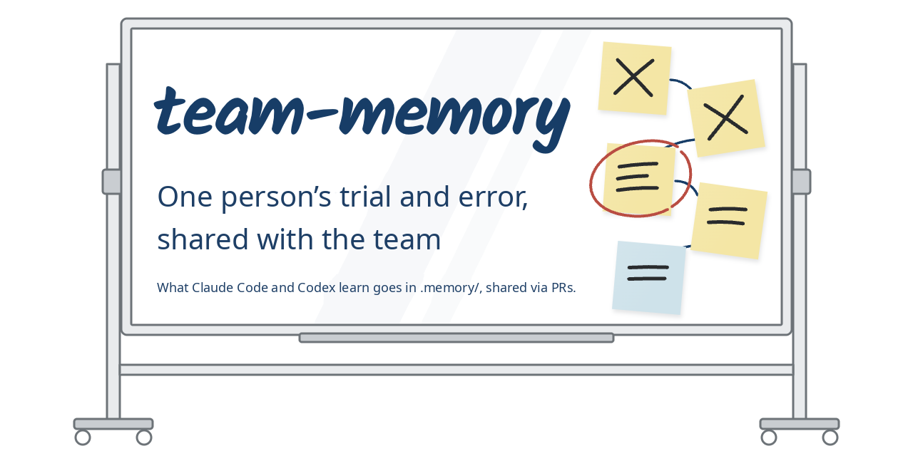
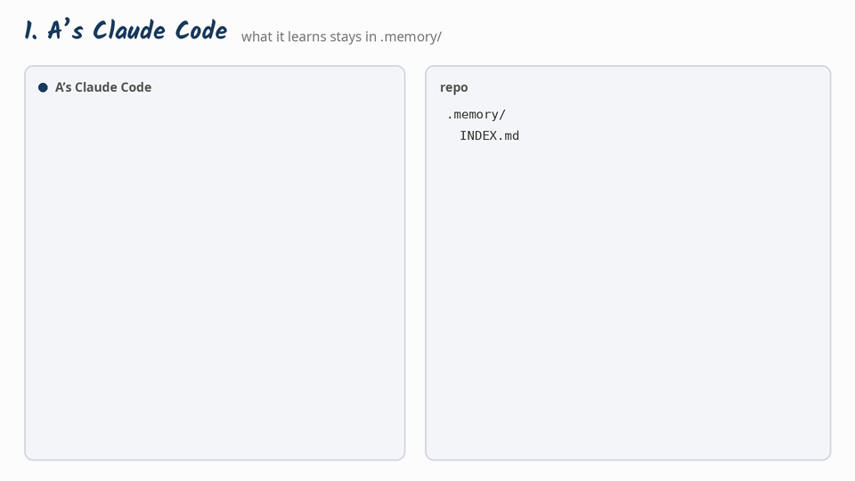

<p align="center"></p>

# team-memory

English | [日本語](README.ja.md)

A skill for Claude Code and Codex. Agents keep what they learn while working in the repo's `.memory/`, and share it with the team through pull requests.

## Why

When several people work on the same repo, each with their own agent, whatever an agent learns through trial and error stays with that one person. Claude Code's auto memory lives only on one machine, and CLAUDE.md and AGENTS.md are for rules and procedures. So another person's agent ends up trying an approach that was already tried and abandoned.

team-memory keeps the following in the repo as Markdown:

- What was decided, and why
- What was tried, and why it was dropped
- What was measured, and under which conditions

Memories are reviewed as part of PRs, and every agent on the team reads them. A PM can also have their own agent gather material for status meetings.

<p align="center"></p>

## What it solves

### Problem: someone tries an approach that was already tried and dropped

A's Claude Code tried binarizing with a fixed threshold. Circles broke up in faint drawings, so A dropped it. But that history lives only in A's local conversation. The next week, B's Claude Code tries the same thing because "it should be faster", and goes through the same failure again.

**Solved:** A's Claude Code writes the reason for dropping it, with the numbers, to `.memory/`, and the PR is merged. Before starting, B's Claude Code looks at `INDEX.md`, opens that memory, and stops: "This was tried on 10/20 and rejected." The GIF above shows this flow.

### Problem: every new conversation repeats the same trial and error

An agent does not remember approaches it dropped in an earlier conversation. Each new conversation starts from the same approach and gets stuck in the same place.

**Solved:** what was tried and why it was dropped stays in the repo, so work picks up where it left off.

### Problem: assumptions in the PM's head never reach the developers' agents

The PM's priorities, their reading of what the client wants, and options they are vaguely considering or have set aside live only in meetings and chat. Developers' agents work without knowing them.

**Solved:** the PM can ask their own agent to "remember this assumption". Once it is in `.memory/`, every agent on the team takes it into account.

### Problem: asking around for the background every time you prepare a status report

**Solved:** the PM's agent builds a section of the report from `.memory/`, filtered by period and issue. It does not copy internal notes, authors or issue numbers.

## Getting started

Run one of the following at the root of the target repo. None of them needs any addition to CLAUDE.md or AGENTS.md. The agent creates `.memory/` when it writes the first memory.

| Method | Agents | When to use |
|---|---|---|
| 1. skills CLI | Claude Code, Codex and others | The team uses both Claude Code and Codex (recommended) |
| 2. Claude Code plugin marketplace | Claude Code | Everyone on the team uses only Claude Code |
| 3. By hand | Claude Code, Codex | Neither npx nor plugins are available |

### 1. skills CLI

Requires Node.js 22.20 or later.

```sh
npx skills add ibukimatsubara/team-memory -a claude-code -a codex -y
```

The [skills](https://github.com/vercel-labs/skills) CLI installs the skill into the repo:

- For Codex: the skill itself in `.agents/skills/team-memory/`
- For Claude Code: a symlink at `.claude/skills/team-memory`
- For update checks: `skills-lock.json`

Commit all three and every agent on the team can use it. Pull in new versions with `npx skills update`.

### 2. Claude Code plugin marketplace

```sh
claude plugin marketplace add ibukimatsubara/team-memory --scope project
claude plugin install team-memory@team-memory --scope project
```

Commit the updated `.claude/settings.json`. When teammates trust the repo folder, Claude Code registers the marketplace and enables the plugin.

- The skill appears as `team-memory:team-memory`.
- It is not installed for Codex.

### 3. By hand

```sh
git clone https://github.com/ibukimatsubara/team-memory.git /tmp/team-memory
mkdir -p .agents/skills .claude/skills
cp -R /tmp/team-memory/skills/team-memory .agents/skills/
ln -s ../../.agents/skills/team-memory .claude/skills/team-memory
```

Commit `.agents/skills/team-memory` and `.claude/skills/team-memory`.

## How it behaves

**Reading**: for work where past decisions may matter, the agent looks at `.memory/INDEX.md` before starting and opens only the related memories. It does not read them for small work such as fixing a typo.

**Writing**: the agent writes a memory when a direction is decided, when an experiment is dropped, and before opening a PR. You can also ask it to "remember this". Attempts dropped without a PR are kept in a memory-only PR. PMs can record their assumptions and set-aside options, not only developers.

**When the direction changes**: the agent rewrites the conclusion of the same memory and adds one line to its history with the date, the previous conclusion and the reason. Related repo documents such as the README or specs are fixed in the same PR.

**As memories grow**: once the INDEX lists more than 100 memories, memories are split into per-area folders and the top INDEX becomes a list of areas. Merged memories and memories whose subject is gone move to `archive/`. When the INDEX does not show something, the agent searches with grep, so it scales. Tidying up happens only when asked.

**Making reports**: ask something like "build this week's status report section from .memory" and the agent writes it from the conclusions and evidence. It does not copy internal notes, authors or issue numbers.

**Language**: memories are written in the language the existing memories in `.memory/` use, or, when there are none yet, in the language of the person working. A team that works in Japanese keeps Japanese memories and headings.

## What a memory looks like

```
.memory/
├── INDEX.md                                  # current memories, one per line (a list of areas past 100)
├── 2026-10-20-fixed-threshold-rejected.md
└── 2026-10-24-eval-set-expanded.md
```

```markdown
---
title: Do not use a fixed threshold for binarization
author: octocat            # GitHub login of the person who directed the work
date: 2026-10-20
status: current            # current / superseded
related:
  - "#12 Improve circle symbol detection accuracy"
---

## Conclusion
Binarize scanned images with an adaptive threshold. Do not use a fixed threshold.
Scope: the scanned images currently accepted. Photo input has not been evaluated.

## Evidence
- Recall: fixed 0.62, adaptive 0.81 (30 evaluation images, measured 2026-10-20, final).

## History
- 2026-10-20: First recorded.

## Revisit when
Preprocessing is added that evens out input darkness.

## Internal notes
(Internal names and background not to be shown outside the team)
```

- When the direction changes, the conclusion in the same file is rewritten and the change is recorded in `History`.
- The conclusion is written in words people outside the team understand. Internal names go in the internal notes.
- The author is the same GitHub account used for commits in that repo.
- Japanese memories use the headings `結論`, `根拠`, `経緯`, `再検討の条件` and `内部メモ`. Both forms are read as the same.

The full rules are in [`skills/team-memory/SKILL.md`](skills/team-memory/SKILL.md).

## Measurements

We measured whether the skill actually behaves this way with Claude Code (Sonnet, Opus) and Codex. Results are in [`experiments/RESULTS.md`](experiments/RESULTS.md).

- With the skill installed, agents read the memories on every related request, without any note in CLAUDE.md or AGENTS.md.
- On unrelated requests, they rarely read them.
- When asked to make a status report, they kept authors, issue numbers and internal names out of it.
- In a repo with 240 memories split into areas, the agent followed the related area's INDEX to the target memory and opened the full text of only that one.
- Asked to change direction, the agent rewrote the conclusion and appended to the history without adding files.

- After the skill was translated into English, agents still read the memories on every related request in both Japanese and English repos, and wrote new memories in the language the repo's memories already use.

These results come from a sample repo and machine-generated memories.

## What is in this repo

- `skills/team-memory/`: the skill
- `DESIGN.md`: design decisions and their reasons
- `experiments/`: scripts and results used to measure the behavior

## License

[MIT](LICENSE)
